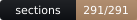

<p align="center">
  
  
  
  
  
  
</p>

# Organon Reader

**The Organon of Medicine, sixth edition, in the 1922 Boericke translation — searchable, bookmarkable and readable with the network off.** No account, no server, no telemetry. Open the page and read.

- **App:** <https://drsamonline.github.io/app-organon-reader/>
- **The text:** *Organon of Medicine*, 6th edition (completed 1842), translated by William Boericke, 1922 — public domain, read from **three** Internet Archive scans of that printing and merged.
- **Built with:** `web-kit`'s storage model, and nothing else. No CDN, no build step, no dependencies.

## What it does

It is a reader, not an interpreter. It presents the text, finds a phrase in it instantly, and keeps your bookmarks and notes on your own device. It does not summarise, advise, or explain Hahnemann.

Search is phrase search over the bundled text. Type `vital force` and every section that contains it is listed, best match first, each with its section number and the line it matched. Open a section and you can bookmark it or write a note; both are stored locally and both come back on the next visit. Under each section number the reader names the scan that section was read from.

## What it refuses to do

- **It does not renumber the book.** OCR loses a section mark here and there — `§ 40` is read as `§ AO,`, `§ 1` as `Si`, `§ 2` as `~ B-`. Three scans of the same printing lose *different* marks, so all three are read and merged: the bundle carries **255 of the 291 sections**, each one recording which scan it came from. The other 36 are unreadable in every scan, and are named on screen rather than renumbered. A reader that quietly renumbered the rest would be worse than a reader with gaps.
- **It does not invent a section to fill a gap.** Nothing in the text is paraphrased, reconstructed or generated.
- **It does not fetch anything.** No `fetch`, no `XMLHttpRequest`, no beacon, no socket, no off-origin `<script>`. The suite asserts all five, and that the bundle hashes the same on a second load.

## When things go wrong

| Situation | What happens |
|---|---|
| A search term of one character | It says the term is too short to search for — not "no matches", which would read as "this phrase is not in the book" |
| A phrase the text does not contain | It says no carried section contains it, and says how many sections it carries |
| Storage full or blocked | The bookmark or note is reported as **not saved**, and is never shown as kept; the write is read back to prove it |
| A corrupt saved file | It is reported, offered back for export, and the text still opens — the bundled text is read-only |
| No network | Nothing changes. There is nothing to fetch. |

## Run it

Open `docs/index.html` — that is the whole app. It works from `file://` and from GitHub Pages, because everything it needs sits beside it.

```
node test-node.js        # the suite: 21 assertions, no dependencies
python3 scripts/badges.py   # redraw the badges above from the suite's own numbers
```

Rebuilding the bundled text from the scans is described in [`data/README.md`](data/README.md), which records the three items used, the SHA-256 of each OCR file, the 36 sections that remain unreadable, and why two other scans were rejected (one cannot read its own marks; the other is a different translation).

## Licence

Code: PolyForm Noncommercial 1.0.0 — free for any noncommercial use; commercial use needs a licence from the author.
Text: public domain (Hahnemann d. 1843; Boericke translation 1922). The text's licence is not the repository's licence, and both are recorded in `data/README.md`.
